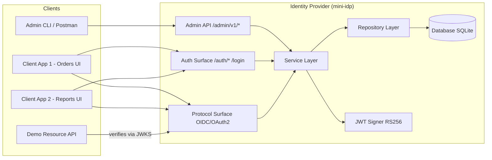
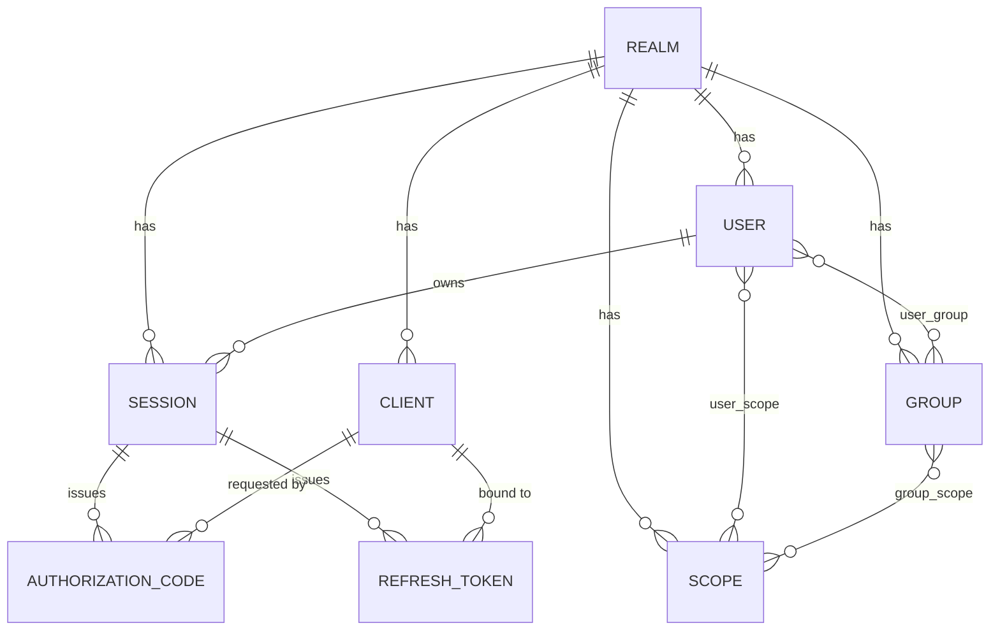

# معماری سامانه — mini-idp

نسخه: ۱.۳ (طراحی + یادداشت‌های پیاده‌سازی)
نویسنده: [نام و نام خانوادگی، شماره دانشجویی]
تاریخ: [تاریخ]

---

## چکیده

mini-idp یک ارائه‌دهندهٔ هویت (Identity Provider) تک‌دامنه و سازگار با OIDC است که از صفر پیاده‌سازی می‌شود و کاربران، گروه‌ها، اسکوپ‌ها و کلاینت‌های OAuth2 را در یک realm مدیریت می‌کند. این سامانه احراز هویت مبتنی بر نشست مرورگری و مجوزدهی مبتنی بر اسکوپ را با جریان Authorization Code + PKCE ترکیب کرده و توکن‌های JWT با امضای RS256 صادر می‌کند. هدف طراحی، تفکیک صریح میان مدیریت (management plane) و اجرا (authentication/protocol plane)، و ارائهٔ یک واحد یکتای محاسبهٔ مجوز («اسکوپ مؤثر») است تا تغییر مجوزها در یک نقطه، در تمام سطوح سامانه بازتاب یابد.

---

## ۱. اهداف و دامنه

### ۱.۱. هدف

سامانه یک IdP مینیمال اما کامل ارائه می‌دهد که:

- کاربران، گروه‌ها، اسکوپ‌ها و کلاینت‌ها را در یک realm مدیریت کند؛
- احراز هویت مرورگری با نشست و کوکی امن ارائه دهد؛
- SSO بین چند کلاینت را در یک مرورگر پشتیبانی کند؛
- endpointهای استاندارد OIDC/OAuth2 (discovery، JWKS، authorize، token، userinfo، introspect، revoke) را پیاده کند؛
- جریان Authorization Code + PKCE را با توکن‌های JWT امضاشده با RS256 اجرا کند؛
- با یک Resource Server دمو، اجرای اسکوپ‌ها را در سمت مصرف‌کننده اثبات کند.

### ۱.۲. اهداف غیرهدف

موارد زیر صریحاً خارج از دامنه‌اند:

- multi-tenancy (تنها یک realm)؛
- ثبت‌نام کاربر توسط خودش؛
- بازیابی رمز از طریق ایمیل؛
- ورود اجتماعی (OAuth2 با ارائه‌دهندهٔ بیرونی)؛
- SAML؛
- رابط کاربری کامل مدیریتی (فقط API و یک فرم ورود مینیمال).

### ۱.۳. محدودیت‌ها

- **تک‌دامنه:** جدول `realm` با یک ردیف مدل می‌شود تا طراحی قابل توسعه بماند، اما رفتار سامانه تک‌دامنه است.
- **استقلال اجرایی:** سامانه نباید از محصولات آمادهٔ IdP (مانند Keycloak یا Duende) در زمان اجرا استفاده کند؛ کتابخانه‌های پروتکل و رمزنگاری مجازند.
- **بی‌حالت‌بودن access token:** اعتبارسنجی access token در Resource Server به‌صورت آفلاین و با JWKS انجام می‌شود؛ سامانه در هر درخواست منبع درگیر نمی‌شود.

---

## ۲. معماری اجزا

### ۲.۱. نمای کلی

سامانه سه سطح منطقی دارد:

1. **سطح مدیریتی** (`/admin/v1/*`) — API مدیریت موجودیت‌ها و تخصیص‌ها، محافظت‌شده با اسکوپ `admin` در Bearer token.
2. **سطح احراز هویت** (`/auth/*` و فرم `/login`) — ورود، نشست، خروج، و بازیابی نشست برای SSO.
3. **سطح پروتکل** (`/.well-known/*`، `/authorize`، `/token`، `/userinfo`، `/introspect`، `/revoke`) — پیاده‌سازی OIDC/OAuth2.

یک **Resource Server دمو** جداگانه، access tokenها را با JWKS اعتبارسنجی و اسکوپ‌ها را اجرا می‌کند. این سرویس بخشی از IdP نیست و تنها برای اثبات end-to-end در دمو وجود دارد.

### ۲.۲. نمودار اجزا



### ۲.۳. مسئولیت‌ها و مرزها

- **Admin API، Auth Surface و Protocol Surface** هر سه تنها به **Service Layer** وابسته‌اند و از دسترسی مستقیم به پایگاه‌داده منع می‌شوند. این وابستگی یک‌طرفه، افزودن پروتکل‌های آینده (مثلاً SAML) را بدون تغییر منطق دامنه ممکن می‌کند و اصل Interface Segregation را در سطح ماژول رعایت می‌کند.
- **Service Layer** تنها نقطهٔ تصمیم‌گیری در مورد مجوز است و تابع «اسکوپ مؤثر» را در اختیار دارد.
- **Repository Layer** دسترسی به داده را ایزوله می‌کند و مهاجرت از SQLite به Postgres را صرفاً با تغییر `DATABASE_URL` ممکن می‌سازد.
- **JWT Signer** کلید خصوصی را در اختیار دارد و صرفاً توسط Service Layer فراخوانی می‌شود.

---

## ۳. مدل داده

### ۳.۱. نمودار ER (موجودیت‌های اصلی)



### ۳.۲. مشخصات جدول‌ها

**`realm`**

| ستون | نوع | ملاحظات |
|---|---|---|
| id | PK | |
| name | text, unique | مثلاً `main` |
| created_at | datetime | |

**`user`**

| ستون | نوع | ملاحظات |
|---|---|---|
| id | PK | |
| realm_id | FK → realm.id | |
| username | text, unique per realm | |
| email | text, nullable | |
| password_hash | text | Argon2id |
| first_name, last_name | text, nullable | |
| enabled | bool | default true |
| created_at, updated_at | datetime | |

**`group`**

| ستون | نوع | ملاحظات |
|---|---|---|
| id | PK | |
| realm_id | FK | |
| name | text, unique per realm | |
| description | text | |
| parent_group_id | FK → group.id, nullable | سلسله‌مراتب یک‌سطحی |
| created_at | datetime | |

**`scope`** — واحد مجوز.

| ستون | نوع | ملاحظات |
|---|---|---|
| id | PK | |
| realm_id | FK | |
| name | text, unique per realm | مثلاً `orders.read` |
| description | text | |
| created_at | datetime | |

**`client`** — کلاینت OIDC.

| ستون | نوع | ملاحظات |
|---|---|---|
| id | PK | |
| realm_id | FK | |
| client_id | text, unique per realm | شناسهٔ عمومی |
| client_name | text | |
| client_secret_hash | text, nullable | برای کلاینت public خالی است |
| redirect_uris | JSON | تطابق دقیق الزامی |
| post_logout_redirect_uris | JSON | |
| allowed_scopes | JSON | اسکوپ‌های قابل درخواست |
| is_public | bool | true = PKCE-only |
| created_at | datetime | |

**`user_group`** — `user_id`, `group_id`, `created_at`.

**`user_scope`** — `user_id`, `scope_id`, `granted_by` (nullable), `created_at`.

**`group_scope`** — `group_id`, `scope_id`, `created_at`.

**`session`** — نشست SSO.

| ستون | نوع | ملاحظات |
|---|---|---|
| id | PK | |
| user_id | FK | |
| realm_id | FK | |
| created_at, expires_at, last_activity_at | datetime | |
| user_agent, ip | text | ممیزی اختیاری |
| revoked_at | datetime, nullable | |

**`authorization_code`**

| ستون | نوع | ملاحظات |
|---|---|---|
| id | PK | |
| code_hash | text, unique | هش؛ هرگز متن ساده |
| client_id | FK | |
| user_id | FK | |
| session_id | FK | گره به نشست SSO |
| redirect_uri | text | تطابق دقیق در `/token` |
| scopes | JSON | درخواستی و اعطاشده |
| code_challenge, code_challenge_method | text | PKCE `S256` |
| nonce | text, nullable | برای ID token |
| state | text, nullable | CSRF در سمت کلاینت |
| created_at, expires_at | datetime | TTL ≤ ۶۰ ثانیه |
| used_at | datetime, nullable | استفادهٔ یک‌باره |

**`refresh_token`**

| ستون | نوع | ملاحظات |
|---|---|---|
| id | PK | |
| token_hash | text, unique | هش‌شده |
| client_id | FK | |
| user_id | FK | |
| session_id | FK | ابطال با خروج |
| scopes | JSON | |
| created_at, expires_at, revoked_at | datetime | |
| rotated_from | FK → refresh_token.id, nullable | زنجیرهٔ چرخش |

### ۳.۳. تصمیم‌های مدل داده

- **ستون‌های `*_hash`** برای `code_hash` و `token_hash` از نشت پایگاه‌داده محافظت می‌کنند؛ حتی با دسترسی کامل به DB، توکن قابل استفاده‌ای در دسترس مهاجم نیست.
- **`used_at` روی `authorization_code`** استفادهٔ یک‌باره را تضمین می‌کند و replay را می‌بندد.
- **`session_id` روی `authorization_code` و `refresh_token`** امکان خروج واقعی SSO را فراهم می‌کند: با ابطال نشست، تمام مشتقات معتبر از کار می‌افتند.
- **`allowed_scopes` روی `client`** از درخواست اسکوپ ناشایست توسط کلاینت جلوگیری می‌کند و `/authorize` می‌تواند اسکوپ‌های خارج از این مجموعه را رد کند.
- **عدم وجود جدول `access_token`:** access tokenها JWT بی‌حالت هستند و به‌صورت آفلاین اعتبارسنجی می‌شوند؛ ذخیرهٔ آن‌ها هدف بی‌حالت‌بودن را نقض می‌کند. ابطال از طریق TTL کوتاه + refresh + introspection مدیریت می‌شود (بخش ۷).
- **عدم وجود جدول `role`:** در این طراحی، اسکوپ‌ها خود واحد مجوز هستند. گروه‌ها صرفاً اسکوپ‌ها را تجمیع می‌کنند. این تصمیم از یک لایهٔ انتزاعی بدون اثر رفتاری در دامنهٔ تمرین جلوگیری می‌کند.
- **عدم وجود `realm_id` روی جدول‌های واسط (`user_group`, `user_scope`, `group_scope`):** این وابستگی از طریق موجودیت‌های والد قابل استنتاج است و در لایهٔ سرویس اعمال می‌شود.

---

## ۴. طراحی API

### ۴.۱. Admin API — نیازمند اسکوپ `admin` در Bearer token

| متد | مسیر | هدف |
|---|---|---|
| POST | `/admin/v1/users` | ایجاد کاربر |
| GET | `/admin/v1/users` | فهرست (صفحه‌بندی‌شده) |
| GET | `/admin/v1/users/{id}` | دریافت کاربر |
| PATCH | `/admin/v1/users/{id}` | به‌روزرسانی |
| POST | `/admin/v1/users/{id}/password` | تعیین/بازنشانی رمز |
| DELETE | `/admin/v1/users/{id}` | غیرفعال‌سازی |
| POST | `/admin/v1/groups` | ایجاد گروه |
| GET | `/admin/v1/groups` | فهرست |
| PATCH | `/admin/v1/groups/{id}` | به‌روزرسانی |
| DELETE | `/admin/v1/groups/{id}` | حذف |
| POST | `/admin/v1/groups/{id}/members/{user_id}` | افزودن عضو |
| DELETE | `/admin/v1/groups/{id}/members/{user_id}` | حذف عضو |
| POST | `/admin/v1/scopes` | ایجاد اسکوپ |
| GET | `/admin/v1/scopes` | فهرست |
| DELETE | `/admin/v1/scopes/{id}` | حذف |
| POST | `/admin/v1/users/{id}/scopes/{scope_id}` | اعطای مستقیم |
| DELETE | `/admin/v1/users/{id}/scopes/{scope_id}` | لغو |
| POST | `/admin/v1/groups/{id}/scopes/{scope_id}` | اعطا به گروه |
| DELETE | `/admin/v1/groups/{id}/scopes/{scope_id}` | لغو |
| POST | `/admin/v1/clients` | ثبت کلاینت |
| GET | `/admin/v1/clients` | فهرست |
| PATCH | `/admin/v1/clients/{client_id}` | به‌روزرسانی |
| DELETE | `/admin/v1/clients/{client_id}` | حذف |
| GET | `/admin/v1/users/{id}/effective-scopes` | اسکوپ‌های مؤثر |
| GET | `/admin/v1/audit` | رخدادهای امنیتی اخیر |

### ۴.۲. سطح احراز هویت

| متد | مسیر | هدف |
|---|---|---|
| POST | `/auth/login` | JSON `{username, password}`؛ ایجاد نشست؛ ست‌کردن کوکی `SID` (HttpOnly, Secure, SameSite=Lax) |
| POST | `/auth/logout` | ابطال نشست و refresh tokenهای مشتق؛ پاک‌کردن کوکی |
| GET | `/auth/session` | برگرداندن `{user, session_exp}` برای نشست معتبر |
| GET | `/login` | فرم HTML مینیمال ورود؛ مقصد redirect از `/authorize` |
| GET | `/consent` | صفحهٔ رضایت برای اعطای اولیهٔ اسکوپ |

وجود هر دو `/login` و `/auth/login` ضروری است: `/authorize` مرورگر را به فرم HTML redirect می‌کند؛ جریان Auth Code بدون فرم HTML در مرورگر قابل نمایش نیست. `/auth/login` برای استفادهٔ API و تست طراحی شده است.

### ۴.۳. سطح پروتکل OIDC/OAuth2

| متد | مسیر | احراز هویت | هدف |
|---|---|---|---|
| GET | `/.well-known/openid-configuration` | عمومی | سند discovery |
| GET | `/.well-known/jwks.json` | عمومی | کلیدهای عمومی |
| GET | `/authorize` | کوکی نشست | شروع Auth Code + PKCE |
| POST | `/token` | احراز هویت کلاینت یا `none` | code → tokens، refresh |
| GET | `/userinfo` | Bearer JWT | claimهای کاربر |
| POST | `/introspect` | احراز هویت کلاینت | RFC 7662 |
| POST | `/revoke` | احراز هویت کلاینت | RFC 7009 |

### ۴.۴. سند Discovery

```json
{
  "issuer": "http://localhost:8000",
  "authorization_endpoint": "http://localhost:8000/authorize",
  "token_endpoint": "http://localhost:8000/token",
  "userinfo_endpoint": "http://localhost:8000/userinfo",
  "jwks_uri": "http://localhost:8000/.well-known/jwks.json",
  "introspection_endpoint": "http://localhost:8000/introspect",
  "revocation_endpoint": "http://localhost:8000/revoke",
  "response_types_supported": ["code"],
  "grant_types_supported": ["authorization_code", "refresh_token"],
  "code_challenge_methods_supported": ["S256"],
  "scopes_supported": ["openid", "profile", "email", "admin"],
  "token_endpoint_auth_methods_supported": ["client_secret_basic", "client_secret_post", "none"],
  "subject_types_supported": ["public"],
  "id_token_signing_alg_values_supported": ["RS256"]
}
```

مقدار `issuer` باید دقیقاً با claim `iss` در توکن‌های صادرشده مطابق باشد؛ ناسازگاری این دو، منبع کلاسیک خطا در اعتبارسنجی توکن است.

### ۴.۵. محاسبه‌گر اسکوپ مؤثر

```text
effective_scopes(user) = direct_scopes(user) ∪ ⋃ group_scopes(g) for g in groups(user)
```

این تابع در Service Layer پیاده می‌شود و **تنها منبع حقیقت** برای مجوزدهی است. مصرف‌کنندگان آن:

- `/authorize` — برای فیلتر اسکوپ‌های درخواستی در برابر اسکوپ‌های مؤثر و `allowed_scopes` کلاینت؛
- `/token` — برای پر کردن claim `scope` در access token؛
- `/userinfo` — برای نمایش اسکوپ‌های مؤثر جاری؛
- Resource Server آینده — به‌صورت غیرمستقیم از طریق claim `scope` در JWT.

در صورت پشتیبانی از سلسله‌مراتب گروه، تشخیص چرخه پیش از محاسبه اجباری است.

---

## ۵. جریان‌های احراز هویت و مجوزدهی

### ۵.۱. ورود و SSO

```text
ClientA -> GET /authorize?response_type=code&client_id=A&redirect_uri=...&scope=openid orders.read
                 &state=...&code_challenge=...&code_challenge_method=S256&nonce=...
  IdP: no SID cookie -> 302 to /login?return_to=<encoded original /authorize URL>
  user submits form -> POST /auth/login
    -> create session, set SID, 302 to return_to
  IdP: with SID, render consent (or skip if previously granted) -> issue code
    -> 302 to redirect_uri?code=...&state=...
ClientA -> POST /token (code + code_verifier)
  IdP: validate code, PKCE, redirect_uri, client, session
    -> issue access_token (JWT RS256), id_token, refresh_token
```

اثبات SSO: در همان مرورگر، `/authorize` برای ClientB فراخوانی می‌شود. به‌دلیل حضور کوکی `SID`، سامانه بدون ورود مجدد کد صادر می‌کند.

### ۵.۲. Refresh

```text
Client -> POST /token grant_type=refresh_token&refresh_token=...&client_id=...
  IdP: validate, check revoked_at, rotate refresh (new token, old marked revoked),
       re-read effective scopes
    -> new access_token with current scopes
```

از آنجا که access tokenها عمر کوتاه دارند و refresh اسکوپ‌های مؤثر را دوباره می‌خواند، لغو یک اسکوپ **حداکثر** پس از TTL access token در توکن‌های صادرشده اثر می‌کند. این پنجره در بخش ۷ به‌عنوان یک trade-off مستند شده است.

### ۵.۳. منبع محافظت‌شده

```text
Resource -> Bearer JWT -> GET /jwks.json (cached)
         -> verify signature, iss, aud, exp, nbf
         -> check required scope in `scope` claim
         -> 200 or 403
```

---

## ۶. تصمیم‌های امنیتی

- **هش رمز عبور با Argon2id** (کتابخانهٔ `argon2-cffi`) — الگوریتم memory-hard؛ در برابر حملات GPU مقاوم‌تر از bcrypt.
- **هش کدهای مجوز و refresh tokenها** — نشت DB منجر به توکن قابل استفاده نمی‌شود.
- **یک‌بارمصرف‌بودن کدها** (`used_at`) و **TTL ≤ ۶۰ ثانیه**.
- **الزام PKCE `S256` برای همهٔ کلاینت‌ها** (public و confidential) — کاهش اثر interception کد.
- **تطابق دقیق `redirect_uri`** در `/authorize` و `/token` — جلوگیری از open redirect و نشت توکن.
- **امضای JWT با RS256** و جفت‌کلید RSA پایدار — Resource Server بدون راز مشترک اعتبارسنجی می‌کند.
- **TTL کوتاه access token (۵ تا ۱۵ دقیقه)**، **ID token ۵ دقیقه**، **refresh بلندمدت (مثلاً ۱۴ روز) با چرخش**.
- **الزام `state` و `nonce`** در جریان Auth Code و جاسازی `nonce` در ID token.
- **کوکی SSO: HttpOnly, Secure, SameSite=Lax** — شناسهٔ تصادفی مات؛ هیچ داده‌ای از کاربر در کوکی ذخیره نمی‌شود.
- **ابطال نشست و refresh tokenها هنگام خروج** — تمام مشتقات از کار می‌افتند.
- **حفاظت از Admin API با اسکوپ `admin` در Bearer token** — سامانه از سازوکار احراز هویت خودش استفاده می‌کند.
- **عدم ورود اسرار به git** — `.env.example` و `.gitignore`؛ کلید خصوصی RSA خارج از مخزن در محیط بارگذاری می‌شود.
- **محدودسازی نرخ ورود** — شمارندهٔ سادهٔ درون‌حافظه‌ای در برابر حملات brute-force.
- **شکل یکسان خطاها** طبق OAuth2: `{"error": "...", "error_description": "..."}`.

---

## ۷. Trade-offها و محدودیت‌ها

1. **JWT بی‌حالت در برابر نشست سمت سرور برای access token.**
   بی‌حالت‌بودن مقیاس‌پذیری و عدم وابستگی در هر درخواست را به‌دنبال دارد؛ اما ابطال فوری access token پیش از انقضا نیازمند introspection یا TTL کوتاه است. تصمیم: access token بی‌حالت + TTL کوتاه + refresh + endpoint introspection. پنجرهٔ ابطال حداکثر برابر TTL access token است و مستند شده است.

2. **تک‌دامنه در برابر multi-tenant.**
   جدول `realm` برای توسعهٔ آینده مدل شده اما تنها یک ردیف دارد. هزینه: ستون‌های FK اضافی. فایده: هم‌راستایی با مدل ذهنی استاندارد IdPها و آمادگی برای توسعه.

3. **اسکوپ به‌عنوان واحد مجوز در برابر نقش + مجوز تودرتو.**
   اسکوپ، واحد بومی OAuth2 است و لایهٔ انتزاعی اضافی ایجاد نمی‌کند. نقش با مجوز تودرتو می‌توانست مدل غنی‌تری ارائه دهد اما در دامنهٔ تمرین تفاوت رفتاری ایجاد نمی‌کرد. تصمیم: اسکوپ مستقیم؛ گروه‌ها تجمیع‌کنندهٔ اسکوپ‌ها هستند.

4. **عمق ارث‌بری گروه.**
   پشتیبانی از `parent_group_id` واقع‌گرایانه است اما محاسبهٔ اسکوپ مؤثر را پیچیده می‌کند (نیاز به تشخیص چرخه و محدودیت عمق). تصمیم: یک سطح تودرتو؛ چرخه با بررسی پیش از درج جلوگیری می‌شود. این نقطه به‌عنوان محور توسعهٔ آینده مستند شده است.

5. **SQLite در برابر Postgres.**
   SQLite برای دموی بدون‌عملیات انتخاب شده است. Repository Layer این انتخاب را ایزوله می‌کند و مهاجرت به Postgres با تغییر `DATABASE_URL` و اجرای مهاجرت‌ها انجام می‌شود.

6. **پنجرهٔ ابطال مجوز در Resource Server.**
   از آنجا که access tokenها آفلاین اعتبارسنجی می‌شوند، لغو یک اسکوپ در سرور IdP فوراً در Resource Server اثر نمی‌کند؛ اثرگذاری حداکثر برابر TTL access token است. برای کوتاه‌کردن این پنجره می‌توان TTL را کاهش داد یا Resource Server را به introspection واداشت؛ هر دو هزینهٔ خود را دارند (بار درخواست یا از دست رفتن مزیت بی‌حالت‌بودن). تصمیم: TTL کوتاه به‌عنوان توازن پیش‌فرض.

---

## ۸. انتخاب پشتهٔ فناوری

| مؤلفه | انتخاب | دلیل معماری |
|---|---|---|
| وب‌فریم‌ورک | FastAPI | ASGI، تایپ‌محور، سازگار با OpenAPI؛ ساده برای پیاده‌سازی endpointهای OIDC |
| ORM | SQLAlchemy 2.x | انتزاع قابل حمل میان SQLite و Postgres؛ ایزوله‌سازی در Repository Layer |
| پایگاه‌داده | SQLite | دموی بدون‌عملیات؛ مسیر مهاجرت به Postgres روشن |
| JWT | PyJWT | امضا و اعتبارسنجی RS256؛ کتابخانهٔ سبک و پرکاربرد |
| هش رمز | argon2-cffi | Argon2id، مقاوم در برابر GPU |
| تست | pytest | پوشش جریان‌های OIDC و حالت‌های خطا |

توجیه تفصیلی هر کتابخانه، مطابق الزامات تمرین، در پیوست گزارش نهایی ارائه می‌شود.

---

## ۹. یادداشت‌های پیاده‌سازی

این بخش، تصمیم‌های جزئی و انحرافات از طراحی را که در جریان پیاده‌سازی اتخاذ شده‌اند مستند می‌کند؛ هر بند به بخش مرتبط طراحی ارجاع می‌دهد تا «تطابق پیاده‌سازی با طراحی» قابل ارزیابی باشد.

### ۹.۱. هدف کلید خارجی `client_id` در `authorization_code` و `refresh_token`

در بخش ۳.۲، ستون `client_id` روی این دو جدول به‌عنوان کلید خارجی توصیف شد اما نوع دقیق ستون هدف مشخص نشد. در پیاده‌سازی، ستون `client_id` به `client.id` (کلید اصلی عددی) ارجاع می‌دهد، نه به `client.client_id` (شناسهٔ عمومی رشته‌ای OAuth2).

**دلیل:** `client.id` کلید داخلی پایگاه‌داده و مناسب روابط ORM و رفتار آبشاری (cascade) است. `client.client_id` شناسهٔ عمومی و صرفاً برای جست‌وجو در سطح API استفاده می‌شود. جدا کردن «کلید مشترک داخلی» از «شناسهٔ عمومی» از پیچیدگی cascade و ایندکس‌گذاری می‌کاهد. نام ستون (`client_id`) بدون تغییر مانده تا با طراحی و با نام‌گذاری استاندارد OAuth2 هم‌خوان بماند.

### ۹.۲. نام کلاس `UserSession` در برابر نام جدول `session`

مدل SSO در بخش ۳.۲ با نام جدول `session` توصیف شد. در پیاده‌سازی، کلاس مدل `UserSession` نامیده شده در حالی که `__tablename__` برابر `session` مانده است.

**دلیل:** `Session` نام کلاس استاندارد `sqlalchemy.orm` است که تقریباً در هر فایل (fixtures تست، سرویس‌ها، endpointها) وارد می‌شود. اگر مدل نیز `Session` نام داشت، تمام فایل‌ها به alias روی می‌آوردند (`from app.models.session import Session as UserSession`). تغییر نام کلاس مدل، این بار را یک‌بار برای همیشه حذف می‌کند و نام جدول در پایگاه‌داده دست‌نخورده می‌ماند.

### ۹.۳. اجبار کلید خارجی در SQLite

SQLite به‌صورت پیش‌فرض FKs را اجرا نمی‌کند؛ بدون `PRAGMA foreign_keys=ON`، رفتار `ondelete="CASCADE"` بی‌اثر می‌شود و «ابطال نشست → مرگ مشتقات» که در بخش ۶ به آن تکیه شده، نقض می‌شود. در `app/db.py` یک listener روی رویداد `connect` پیاده شده که برای اتصال‌های SQLite این pragma را فعال می‌کند. Postgres نیازی به این تنظیم ندارد و رفتار پیش‌فرض آن FKs را اجرا می‌کند؛ به همین دلیل listener فقط در مسیر SQLite عمل می‌کند.

### ۹.۴. بارگذاری روابط M2M با `lazy="selectin"`

روابط `User.groups`، `User.direct_scopes` و `Group.scopes` با `lazy="selectin"` پیکربندی شده‌اند تا N+1 در محاسبهٔ اسکوپ مؤثر و در پاسخ‌های مدیریتی از بین برود. این انتخاب، هزینهٔ دو کوئری اضافی در بازیدهای «سبک» را می‌پذیرد تا هزینهٔ N+1 در بازیدهای «سنگین» حذف شود. مسیرهای گرمی که به این روابط نیاز ندارند می‌توانند با `.options(noload(...))` از آن‌ها صرف‌نظر کنند.

### ۹.۵. اشتقاق `kid`

`kid` در هدر JWT با گرفتن ۱۶ کاراکتر اول SHA-256 از بایت‌های کلید عمومی محاسبه می‌شود. این روش، سادگی را بر تطابق کامل با RFC 7638 (JWK Thumbprint) ترجیح می‌دهد اما همان ویژگی حیاتی را حفظ می‌کند: برای یک کلید ثابت، `kid` در همهٔ اجراها یکسان است و با بازتولید کلید تغییر می‌کند. این ویژگی، چرخش بی‌وقفهٔ کلید در استقرار آینده را ممکن می‌سازد.

### ۹.۶. پارامترهای هش رمز

`argon2.PasswordHasher()` با پارامترهای پیش‌فرض کتابخانه استفاده می‌شود: `time_cost=3`، `memory_cost=64 MiB`، `parallelism=4`. این مقادیر با توصیه‌نامهٔ OWASP برای Argon2id (۲۰۲۴) هم‌خوان‌اند. برای مهاجرت به پارامترهای سخت‌گیرانه‌تر در آینده، تابع `needs_rehash` در `app/security/passwords.py` فراهم است تا در زمان ورود کاربر، هش قدیمی بازنویسی شود.

### ۹.۷. ستون‌های JSON روی SQLite

ستون‌های `redirect_uris`، `post_logout_redirect_uris`، `allowed_scopes` و `scopes` از نوع `sqlalchemy.dialects.sqlite.JSON` هستند. این انتخاب، در SQLite به TEXT با سریال‌سازی JSON نگاشت می‌شود و در Postgres به `JSONB` نگاشت می‌شود. برای مهاجرت کامل به Postgres، تغییر import به `sqlalchemy.JSON` کافی است.

### ۹.۸. مقدار پیش‌فرض برای ستون‌های لیستی JSON

ستون‌های JSON لیستی با `default=list` مقدار می‌گیرند تا `None` هرگز به‌جای آرایهٔ خالی وارد نشود. این انتخاب، هزینهٔ صفر دارد و از خطای type در سرویس‌های بالادستی (که انتظار iterable دارند) جلوگیری می‌کند.

### ۹.۹. نگاشت هویت ORM و نوشتن‌های سطح Core روی جدول‌های واسط

سرویس‌هایی که جدول‌های واسط (`user_scope`، `group_scope`، `user_group`) را تغییر می‌دهند، از عملیات درج/حذف سطح Core استفاده می‌کنند (`db.execute(user_scope.insert()/delete())`) تا ستون `granted_by` روی `user_scope` حفظ شود؛ چون `user.scopes.append(...)` در سطح ORM امکان نوشتن این ستون را ندارد. نوشتن‌های Core از دفترداری روابط ORM عبور نمی‌کنند و به همین دلیل مجموعه‌های M2M موجود در نگاشت هویت (identity map) نشست می‌توانند کهنه بمانند.

مشکل در تست‌ها آشکار شد: پس از `add_member`، `remove_member`، `grant_scope_to_group`، `revoke_scope_from_group` و `revoke_scope_from_user`، فراخوانی `compute_effective_scopes` مجموعه‌های قدیمی را از نگاشت هویت می‌خواند و نتیجهٔ نادرست برمی‌گرداند؛ صرفاً `grant_scope_to_user` که `db.refresh(user)` را صریحاً صدا می‌زد، درست عمل می‌کرد.

**راه‌حل انتخابی:** تابع `compute_effective_scopes` با گزینهٔ اجرایی `populate_existing=True` اجرا می‌شود. این گزینه، گزینه‌های بارگذاری مشتاقانه (`selectinload` / `joinedload`) را وادار می‌کند حتی اگر شیء در نگاشت هویت حاضر باشد، مجموعه‌ها را از پایگاه‌داده بازنویسی کنند. نتیجه: resolver همیشه وضعیت جاری DB را می‌خواند، مستقل از آنچه در حافظهٔ نشست انباشته شده است.

**جایگزینی که کنار گذاشته شد:** الگوی «شیء انجمنی» با یک کلاس ORM برای هر جدول واسط (`UserScope`، `GroupScope`، `UserGroup`). این الگو نگاشت هویت را به‌طور خودکار سازگار نگه می‌دارد، اما سه کلاس مدل جدید به ازای هر رابطهٔ M2M اضافه می‌کند و فراخوان‌ها را از `user.scopes.append(...)` به `session.add(UserScope(...))` تغییر می‌دهد.

**Trade-off:** راه‌حل انتخابی هزینهٔ یک بازخوانی اجباری در resolver را می‌پذیرد (هزینهٔ ناچیز در این مقیاس، چون resolver پیش‌تر هم با `selectinload` چهار کوئری می‌زد و هزینهٔ اصلی همان است) در عوض، یک لایهٔ مدل اضافی اضافه نمی‌کند، ستون `granted_by` را حفظ می‌کند، و اجازه می‌دهد منطق «اسکوپ مؤثر» تنها در یک نقطه — طبق §۴.۵ — پابرجا بماند. این تصمیم هم‌راستا با اصل «تک‌منبع حقیقت» در طراحی است: resolver مسئول تازگی داده است، نه هر فراخوان.

### ۹.۱۰. تنظیم موتور تست: `StaticPool` و `check_same_thread=False`

FastAPI توابع مسیر (route handler) همگام را در threadpool اجرا می‌کند، بنابراین تست‌هایی که لایهٔ HTTP را فراخوانی می‌کنند، از threadی متفاوت با thread سازندهٔ نشست، به آن دسترسی دارند. دو شکست در تست‌ها این نیاز را آشکار کرد:

- `sqlite3.ProgrammingError: SQLite objects created in a thread can only be used in that same thread`
- `sqlite3.OperationalError: no such table: user` — چون SQLAlchemy برای `:memory:` به‌طور پیش‌فرض از `SingletonThreadPool` استفاده می‌کند که برای هر thread، اتصال جداگانه (و در نتیجه پایگاه‌دادهٔ جداگانهٔ خالی) می‌سازد.

**راه‌حل:** موتور تست با `poolclass=StaticPool` و `connect_args={"check_same_thread": False}` ساخته می‌شود. `StaticPool` یک اتصال مشترک را میان همهٔ threadها برمی‌گرداند و `check_same_thread=False` محافظ cross-thread درایور sqlite3 را غیرفعال می‌کند. علاوه بر این، listener فعال‌سازی `PRAGMA foreign_keys=ON` که `app/db.py` در زمان اجرا نصب می‌کند، در موتور تست نیز نصب می‌شود تا رفتار `ondelete="CASCADE"` در تست‌ها و در اجرای واقعی یکسان باشد.

**چرا این الگو امن است:** `TestClient` همگام است — thread اصلی در انتظار پاسخ بلاک می‌شود در حالی که thread کارگر در حال اجراست، بنابراین دسترسی هم‌زمان به نشست وجود ندارد. این الگوی مستند SQLAlchemy برای تست in-memory با چند thread است و در اسناد رسمی به‌عنوان راه‌حل استاندارد معرفی شده.

**جایگزین کنار گذاشته‌شده:** پایگاه‌دادهٔ فایلی موقت با `tmp_path` در هر تست. یکسان کار می‌کند اما نیازمند پاک‌سازی صریح، مدیریت هم‌زمانی فایل، و کندتر است. `StaticPool` بدون هیچ فایل روی دیسک، همان ایزوله‌بودن را فراهم می‌کند.

**افزوده — اشتقاق scope در توکن از پایگاه‌داده:** نسخهٔ اولیهٔ اسکریپت، claim `scope` را به‌صورت ثابت (`"openid profile email admin"`) در توکن قرار می‌داد، در حالی که در DB فقط اسکوپ `admin` به کاربر مدیر اعطا شده بود. این ناسازگاری در دموی مسیر محافظت‌شده آشکار شد: پاسخ `GET /admin/v1/users/1/effective-scopes` مجموعهٔ `["admin"]` را برگرداند، در حالی که توکن ادعای چهار اسکوپ داشت. اسکریپت اصلاح شد تا (الف) هر چهار اسکوپ استاندارد (`openid`, `profile`, `email`, `admin`) را به کاربر مدیر اعطا کند، و (ب) claim `scope` را با فراخوانی `compute_effective_scopes` از پایگاه‌داده مشتق کند. این اصلاح، همان اصل §۴.۵ را در خود اسکریپت بوت‌استرپ اجرا می‌کند: هیچ‌جا نباید مجموعهٔ اسکوپ‌ها به‌صورت ثابت نوشته شود که ممکن است با وضعیت DB واگرا شود.