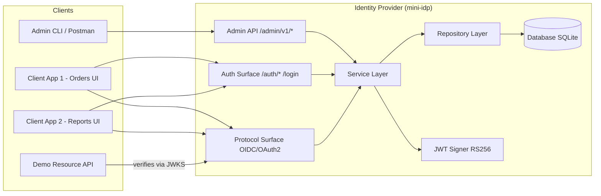
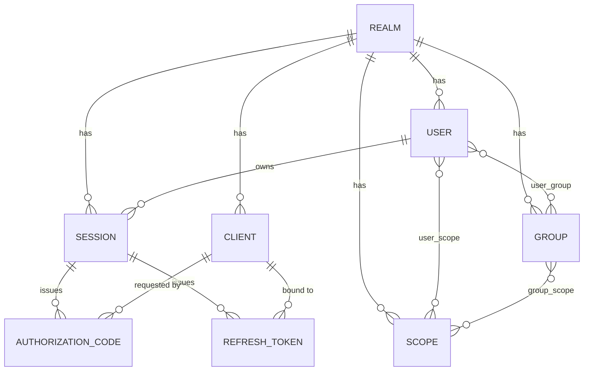

# معماری سامانه
## چکیده
این برنامه یک ارائه‌دهندهٔ هویت (Identity Provider) تک‌دامنه و سازگار با OIDC است که از صفر پیاده‌سازی می‌شود و کاربران، گروه‌ها، اسکوپ‌ها و کلاینت‌های OAuth2 را در یک realm مدیریت می‌کند. این سامانه احراز هویت مبتنی بر نشست مرورگری و مجوزدهی مبتنی بر اسکوپ را با جریان Authorization Code + PKCE ترکیب کرده و توکن‌های JWT با امضای RS256 صادر می‌کند. هدف طراحی، تفکیک صریح میان مدیریت (management plane) و اجرا (authentication/protocol plane)، و ارائهٔ یک واحد یکتای محاسبهٔ مجوز («اسکوپ مؤثر») است تا تغییر مجوزها در یک نقطه، در تمام سطوح سامانه بازتاب یابد.

---

## ۱. اهداف و دامنه
### ۱.۱. هدف
سامانه یک IdP مینیمال اما کامل ارائه می‌دهد که:

- کاربران، گروه‌ها، اسکوپ‌ها و کلاینت‌ها را در یک realm مدیریت کند؛

- احراز هویت مرورگری با نشست و کوکی امن ارائه دهد؛

- SSO بین چند کلاینت را در یک مرورگر پشتیبانی کند؛

- endpointهای استاندارد OIDC/OAuth2 (discovery، JWKS، authorize، token، userinfo، introspect، revoke) را پیاده کند؛

- جریان Authorization Code + PKCE را با توکن‌های JWT امضاشده با RS256 اجرا کند؛

- با یک Resource Server دمو، اجرای اسکوپ‌ها را در سمت مصرف‌کننده اثبات کند.

### ۱.۲. مواردی که در این پیاده‌سازی از دامنه خارجند
موارد زیر صریحاً خارج از دامنه‌اند:

- multi-tenancy (تنها یک realm)؛

- ثبت‌نام کاربر توسط خودش؛

- بازیابی رمز از طریق ایمیل؛

- ورود اجتماعی (OAuth2 با ارائه‌دهندهٔ بیرونی)؛

- SAML؛

- رابط کاربری کامل مدیریتی (فقط API و یک فرم ورود مینیمال).

### ۱.۳. محدودیت‌ها
- **تک‌دامنه:** جدول `realm` با یک ردیف مدل می‌شود تا طراحی قابل توسعه بماند، اما رفتار سامانه تک‌دامنه است.

- **استقلال اجرایی:** سامانه نباید از محصولات آمادهٔ IdP (مانند Keycloak یا Duende) در زمان اجرا استفاده کند؛ کتابخانه‌های پروتکل و رمزنگاری مجازند.

- **بی‌حالت‌بودن access token:** اعتبارسنجی access token در Resource Server به‌صورت آفلاین و با JWKS انجام می‌شود؛ سامانه در هر درخواست منبع درگیر نمی‌شود.

---

## ۲. معماری اجزا
### ۲.۱. نمای کلی
سامانه سه سطح منطقی دارد:

- **سطح مدیریتی** (`/admin/v1/*`) — API مدیریت موجودیت‌ها و تخصیص‌ها، محافظت‌شده با اسکوپ `admin` در Bearer token.

- **سطح احراز هویت** (`/auth/*` و فرم `/login`) — ورود، نشست، خروج، و بازیابی نشست برای SSO.

- **سطح پروتکل** (`/.well-known/*`، `/authorize`، `/token`، `/userinfo`، `/introspect`، `/revoke`) — پیاده‌سازی OIDC/OAuth2.

یک **Resource Server دمو** جداگانه، access tokenها را با JWKS اعتبارسنجی و اسکوپ‌ها را اجرا می‌کند. این سرویس بخشی از IdP نیست و تنها برای اثبات end-to-end در دمو وجود دارد.

### ۲.۲. نمودار اجزا



### ۲.۳. مسئولیت‌ها و مرزها
- **Admin API، Auth Surface و Protocol Surface** هر سه تنها به **Service Layer** وابسته‌اند و از دسترسی مستقیم به پایگاه‌داده منع می‌شوند. این وابستگی یک‌طرفه، افزودن پروتکل‌های آینده (مثلاً SAML) را بدون تغییر منطق دامنه ممکن می‌کند و اصل Interface Segregation را در سطح ماژول رعایت می‌کند.

- **Service Layer** تنها نقطهٔ تصمیم‌گیری در مورد مجوز است و تابع «اسکوپ مؤثر» را در اختیار دارد.

- **Repository Layer** دسترسی به داده را ایزوله می‌کند و مهاجرت از SQLite به Postgres را صرفاً با تغییر `DATABASE_URL` ممکن می‌سازد.

- **JWT Signer** کلید خصوصی را در اختیار دارد و صرفاً توسط Service Layer فراخوانی می‌شود.

---

## ۳. مدل داده
### ۳.۱. نمودار ER (موجودیت‌های اصلی)



### ۳.۲. مشخصات جدول‌ها
`realm`

| ستون | نوع | ملاحظات |
| --- | --- | --- |
| id | PK |  |
| name | text, unique | مثلاً `main` |
| created_at | datetime |  |

`user`

| ستون | نوع | ملاحظات |
| --- | --- | --- |
| id | PK |  |
| realm_id | FK → realm.id |  |
| username | text, unique per realm |  |
| email | text, nullable |  |
| password_hash | text | Argon2id |
| first_name, last_name | text, nullable |  |
| enabled | bool | default true |
| created_at, updated_at | datetime |  |

`group`

| ستون | نوع | ملاحظات |
| --- | --- | --- |
| id | PK |  |
| realm_id | FK |  |
| name | text, unique per realm |  |
| description | text |  |
| parent_group_id | FK → group.id, nullable | سلسله‌مراتب یک‌سطحی |
| created_at | datetime |  |

`scope` — واحد مجوز.

| ستون | نوع | ملاحظات |
| --- | --- | --- |
| id | PK |  |
| realm_id | FK |  |
| name | text, unique per realm | مثلاً `orders.read` |
| description | text |  |
| created_at | datetime |  |

`client` — کلاینت OIDC.

| ستون | نوع | ملاحظات |
| --- | --- | --- |
| id | PK |  |
| realm_id | FK |  |
| client_id | text, unique per realm | شناسهٔ عمومی |
| client_name | text |  |
| client_secret_hash | text, nullable | برای کلاینت public خالی است |
| redirect_uris | JSON | تطابق دقیق الزامی |
| post_logout_redirect_uris | JSON |  |
| allowed_scopes | JSON | اسکوپ‌های قابل درخواست |
| is_public | bool | true = PKCE-only |
| created_at | datetime |  |

`user_group` — `user_id`, `group_id`, `created_at`.

`user_scope` — `user_id`, `scope_id`, `granted_by` (nullable), `created_at`.

`group_scope` — `group_id`, `scope_id`, `created_at`.

`session` — نشست SSO.

| ستون | نوع | ملاحظات |
| --- | --- | --- |
| id | PK |  |
| user_id | FK |  |
| realm_id | FK |  |
| created_at, expires_at, last_activity_at | datetime |  |
| user_agent, ip | text | ممیزی اختیاری |
| revoked_at | datetime, nullable |  |

`authorization_code`

| ستون | نوع | ملاحظات |
| --- | --- | --- |
| id | PK |  |
| code_hash | text, unique | هش؛ هرگز متن ساده |
| client_id | FK |  |
| user_id | FK |  |
| session_id | FK | گره به نشست SSO |
| redirect_uri | text | تطابق دقیق در `/token` |
| scopes | JSON | درخواستی و اعطاشده |
| code_challenge, code_challenge_method | text | PKCE `S256` |
| nonce | text, nullable | برای ID token |
| state | text, nullable | CSRF در سمت کلاینت |
| created_at, expires_at | datetime | TTL ≤ ۶۰ ثانیه |
| used_at | datetime, nullable | استفادهٔ یک‌باره |

`refresh_token`

| ستون | نوع | ملاحظات |
| --- | --- | --- |
| id | PK |  |
| token_hash | text, unique | هش‌شده |
| client_id | FK |  |
| user_id | FK |  |
| session_id | FK | ابطال با خروج |
| scopes | JSON |  |
| created_at, expires_at, revoked_at | datetime |  |
| rotated_from | FK → refresh_token.id, nullable | زنجیرهٔ چرخش |

### ۳.۳. تصمیم‌های مدل داده
- **ستون‌های **`*_hash` برای `code_hash` و `token_hash` از نشت پایگاه‌داده محافظت می‌کنند؛ حتی با دسترسی کامل به DB، توکن قابل استفاده‌ای در دسترس مهاجم نیست.

- `used_at`** روی **`authorization_code` استفادهٔ یک‌باره را تضمین می‌کند و replay را می‌بندد.

- `session_id`** روی **`authorization_code`** و **`refresh_token` امکان خروج واقعی SSO را فراهم می‌کند: با ابطال نشست، تمام مشتقات معتبر از کار می‌افتند.

- `allowed_scopes`** روی **`client` از درخواست اسکوپ ناشایست توسط کلاینت جلوگیری می‌کند و `/authorize` می‌تواند اسکوپ‌های خارج از این مجموعه را رد کند.

- **عدم وجود جدول **`access_token`**:** access tokenها JWT بی‌حالت هستند و به‌صورت آفلاین اعتبارسنجی می‌شوند؛ ذخیرهٔ آن‌ها هدف بی‌حالت‌بودن را نقض می‌کند. ابطال از طریق TTL کوتاه + refresh + introspection مدیریت می‌شود (بخش ۷).

- **عدم وجود جدول **`role`**:** در این طراحی، اسکوپ‌ها خود واحد مجوز هستند. گروه‌ها صرفاً اسکوپ‌ها را تجمیع می‌کنند. این تصمیم از یک لایهٔ انتزاعی بدون اثر رفتاری در دامنهٔ تمرین جلوگیری می‌کند.

- **عدم وجود **`realm_id`** روی جدول‌های واسط (**`user_group`**, **`user_scope`**, **`group_scope`**):** این وابستگی از طریق موجودیت‌های والد قابل استنتاج است و در لایهٔ سرویس اعمال می‌شود.

---

## ۴. طراحی API
### ۴.۱. Admin API — نیازمند اسکوپ `admin` در Bearer token
| متد | مسیر | هدف |
| --- | --- | --- |
| POST | `/admin/v1/users` | ایجاد کاربر |
| GET | `/admin/v1/users` | فهرست (صفحه‌بندی‌شده) |
| GET | `/admin/v1/users/{id}` | دریافت کاربر |
| PATCH | `/admin/v1/users/{id}` | به‌روزرسانی |
| POST | `/admin/v1/users/{id}/password` | تعیین/بازنشانی رمز |
| DELETE | `/admin/v1/users/{id}` | غیرفعال‌سازی |
| POST | `/admin/v1/groups` | ایجاد گروه |
| GET | `/admin/v1/groups` | فهرست |
| PATCH | `/admin/v1/groups/{id}` | به‌روزرسانی |
| DELETE | `/admin/v1/groups/{id}` | حذف |
| POST | `/admin/v1/groups/{id}/members/{user_id}` | افزودن عضو |
| DELETE | `/admin/v1/groups/{id}/members/{user_id}` | حذف عضو |
| POST | `/admin/v1/scopes` | ایجاد اسکوپ |
| GET | `/admin/v1/scopes` | فهرست |
| DELETE | `/admin/v1/scopes/{id}` | حذف |
| POST | `/admin/v1/users/{id}/scopes/{scope_id}` | اعطای مستقیم |
| DELETE | `/admin/v1/users/{id}/scopes/{scope_id}` | لغو |
| POST | `/admin/v1/groups/{id}/scopes/{scope_id}` | اعطا به گروه |
| DELETE | `/admin/v1/groups/{id}/scopes/{scope_id}` | لغو |
| POST | `/admin/v1/clients` | ثبت کلاینت |
| GET | `/admin/v1/clients` | فهرست |
| PATCH | `/admin/v1/clients/{client_id}` | به‌روزرسانی |
| DELETE | `/admin/v1/clients/{client_id}` | حذف |
| GET | `/admin/v1/users/{id}/effective-scopes` | اسکوپ‌های مؤثر |
| GET | `/admin/v1/audit` | رخدادهای امنیتی اخیر |

### ۴.۲. سطح احراز هویت
| متد | مسیر | هدف |
| --- | --- | --- |
| POST | `/auth/login` | JSON `{username, password}`؛ ایجاد نشست؛ ست‌کردن کوکی `SID` (HttpOnly, Secure, SameSite=Lax) |
| POST | `/auth/logout` | ابطال نشست و refresh tokenهای مشتق؛ پاک‌کردن کوکی |
| GET | `/auth/session` | برگرداندن `{user, session_exp}` برای نشست معتبر |
| GET | `/login` | فرم HTML مینیمال ورود؛ مقصد redirect از `/authorize` |
| GET | `/consent` | صفحهٔ رضایت برای اعطای اولیهٔ اسکوپ |

وجود هر دو `/login` و `/auth/login` ضروری است: `/authorize` مرورگر را به فرم HTML redirect می‌کند؛ جریان Auth Code بدون فرم HTML در مرورگر قابل نمایش نیست. `/auth/login` برای استفادهٔ API و تست طراحی شده است.

### ۴.۳. سطح پروتکل OIDC/OAuth2
| متد | مسیر | احراز هویت | هدف |
| --- | --- | --- | --- |
| GET | `/.well-known/openid-configuration` | عمومی | سند discovery |
| GET | `/.well-known/jwks.json` | عمومی | کلیدهای عمومی |
| GET | `/authorize` | کوکی نشست | شروع Auth Code + PKCE |
| POST | `/token` | احراز هویت کلاینت یا `none` | code → tokens، refresh |
| GET | `/userinfo` | Bearer JWT | claimهای کاربر |
| POST | `/introspect` | احراز هویت کلاینت | RFC 7662 |
| POST | `/revoke` | احراز هویت کلاینت | RFC 7009 |

### ۴.۴. سند Discovery
```json
{
  "issuer": "http://localhost:8000",
  "authorization_endpoint": "http://localhost:8000/authorize",
  "token_endpoint": "http://localhost:8000/token",
  "userinfo_endpoint": "http://localhost:8000/userinfo",
  "jwks_uri": "http://localhost:8000/.well-known/jwks.json",
  "introspection_endpoint": "http://localhost:8000/introspect",
  "revocation_endpoint": "http://localhost:8000/revoke",
  "response_types_supported": ["code"],
  "grant_types_supported": ["authorization_code", "refresh_token"],
  "code_challenge_methods_supported": ["S256"],
  "scopes_supported": ["openid", "profile", "email", "admin"],
  "token_endpoint_auth_methods_supported": ["client_secret_basic", "client_secret_post", "none"],
  "subject_types_supported": ["public"],
  "id_token_signing_alg_values_supported": ["RS256"]
}

```
مقدار `issuer` باید دقیقاً با claim `iss` در توکن‌های صادرشده مطابق باشد؛ ناسازگاری این دو، منبع کلاسیک خطا در اعتبارسنجی توکن است.

### ۴.۵. محاسبه‌گر اسکوپ مؤثر
```text
effective_scopes(user) = direct_scopes(user) ∪ ⋃ group_scopes(g) for g in groups(user)

```
این تابع در Service Layer پیاده می‌شود و **تنها منبع حقیقت** برای مجوزدهی است. مصرف‌کنندگان آن:

- `/authorize` — برای فیلتر اسکوپ‌های درخواستی در برابر اسکوپ‌های مؤثر و `allowed_scopes` کلاینت؛

- `/token` — برای پر کردن claim `scope` در access token؛

- `/userinfo` — برای نمایش اسکوپ‌های مؤثر جاری؛

- Resource Server آینده — به‌صورت غیرمستقیم از طریق claim `scope` در JWT.

در صورت پشتیبانی از سلسله‌مراتب گروه، تشخیص چرخه پیش از محاسبه اجباری است.

---

## ۵. جریان‌های احراز هویت و مجوزدهی
### ۵.۱. ورود و SSO
```text
ClientA -> GET /authorize?response_type=code&client_id=A&redirect_uri=...&scope=openid orders.read
                 &state=...&code_challenge=...&code_challenge_method=S256&nonce=...
  IdP: no SID cookie -> 302 to /login?return_to=<encoded original /authorize URL>
  user submits form -> POST /auth/login
    -> create session, set SID, 302 to return_to
  IdP: with SID, render consent (or skip if previously granted) -> issue code
    -> 302 to redirect_uri?code=...&state=...
ClientA -> POST /token (code + code_verifier)
  IdP: validate code, PKCE, redirect_uri, client, session
    -> issue access_token (JWT RS256), id_token, refresh_token

```
اثبات SSO: در همان مرورگر، `/authorize` برای ClientB فراخوانی می‌شود. به‌دلیل حضور کوکی `SID`، سامانه بدون ورود مجدد کد صادر می‌کند.

### ۵.۲. Refresh
```text
Client -> POST /token grant_type=refresh_token&refresh_token=...&client_id=...
  IdP: validate, check revoked_at, rotate refresh (new token, old marked revoked),
       re-read effective scopes
    -> new access_token with current scopes

```
از آنجا که access tokenها عمر کوتاه دارند و refresh اسکوپ‌های مؤثر را دوباره می‌خواند، لغو یک اسکوپ **حداکثر** پس از TTL access token در توکن‌های صادرشده اثر می‌کند. این پنجره در بخش ۷ به‌عنوان یک trade-off مستند شده است.

### ۵.۳. منبع محافظت‌شده
```text
Resource -> Bearer JWT -> GET /jwks.json (cached)
         -> verify signature, iss, aud, exp, nbf
         -> check required scope in `scope` claim
         -> 200 or 403

```

---

## ۶. تصمیم‌های امنیتی
- **هش رمز عبور با Argon2id** (کتابخانهٔ `argon2-cffi`) — الگوریتم memory-hard؛ در برابر حملات GPU مقاوم‌تر از bcrypt.

- **هش کدهای مجوز و refresh tokenها** — نشت DB منجر به توکن قابل استفاده نمی‌شود.

- **یک‌بارمصرف‌بودن کدها** (`used_at`) و **TTL ≤ ۶۰ ثانیه**.

- **الزام PKCE **`S256`** برای همهٔ کلاینت‌ها** (public و confidential) — کاهش اثر interception کد.

- **تطابق دقیق **`redirect_uri` در `/authorize` و `/token` — جلوگیری از open redirect و نشت توکن.

- **امضای JWT با RS256** و جفت‌کلید RSA پایدار — Resource Server بدون راز مشترک اعتبارسنجی می‌کند.

- **TTL کوتاه access token (۵ تا ۱۵ دقیقه)**، **ID token ۵ دقیقه**، **refresh بلندمدت (مثلاً ۱۴ روز) با چرخش**.

- **الزام **`state`** و **`nonce` در جریان Auth Code و جاسازی `nonce` در ID token.

- **کوکی SSO: HttpOnly, Secure, SameSite=Lax** — شناسهٔ تصادفی مات؛ هیچ داده‌ای از کاربر در کوکی ذخیره نمی‌شود.

- **ابطال نشست و refresh tokenها هنگام خروج** — تمام مشتقات از کار می‌افتند.

- **حفاظت از Admin API با اسکوپ **`admin`** در Bearer token** — سامانه از سازوکار احراز هویت خودش استفاده می‌کند.

- **عدم ورود Secretها به git** — `.env.example` و `.gitignore`؛ کلید خصوصی RSA خارج از مخزن در محیط بارگذاری می‌شود.

- **محدودسازی نرخ ورود** — شمارندهٔ سادهٔ درون‌حافظه‌ای در برابر حملات brute-force.

- **شکل یکسان خطاها** طبق OAuth2: `{"error": "...", "error_description": "..."}`.

---

## ۷. Trade-offها و محدودیت‌ها
- **JWT بی‌حالت در برابر نشست سمت سرور برای access token.**
بی‌حالت‌بودن مقیاس‌پذیری و عدم وابستگی در هر درخواست را به‌دنبال دارد؛ اما ابطال فوری access token پیش از انقضا نیازمند introspection یا TTL کوتاه است. تصمیم: access token بی‌حالت + TTL کوتاه + refresh + endpoint introspection. پنجرهٔ ابطال حداکثر برابر TTL access token است و مستند شده است.

- **تک‌دامنه در برابر multi-tenant.**
جدول `realm` برای توسعهٔ آینده مدل شده اما تنها یک ردیف دارد. هزینه: ستون‌های FK اضافی. فایده: هم‌راستایی با مدل ذهنی استاندارد IdPها و آمادگی برای توسعه.

- **اسکوپ به‌عنوان واحد مجوز در برابر نقش + مجوز تودرتو.**
اسکوپ، واحد بومی OAuth2 است و لایهٔ انتزاعی اضافی ایجاد نمی‌کند. نقش با مجوز تودرتو می‌توانست مدل غنی‌تری ارائه دهد اما در دامنهٔ تمرین تفاوت رفتاری ایجاد نمی‌کرد. تصمیم: اسکوپ مستقیم؛ گروه‌ها تجمیع‌کنندهٔ اسکوپ‌ها هستند.

- **عمق ارث‌بری گروه.**
پشتیبانی از `parent_group_id` واقع‌گرایانه است اما محاسبهٔ اسکوپ مؤثر را پیچیده می‌کند (نیاز به تشخیص چرخه و محدودیت عمق). تصمیم: یک سطح تودرتو؛ چرخه با بررسی پیش از درج جلوگیری می‌شود. این نقطه به‌عنوان محور توسعهٔ آینده مستند شده است.

- **SQLite در برابر Postgres.**
SQLite برای دموی بدون‌عملیات انتخاب شده است. Repository Layer این انتخاب را ایزوله می‌کند و مهاجرت به Postgres با تغییر `DATABASE_URL` و اجرای مهاجرت‌ها انجام می‌شود.

- **پنجرهٔ ابطال مجوز در Resource Server.**
از آنجا که access tokenها آفلاین اعتبارسنجی می‌شوند، لغو یک اسکوپ در سرور IdP فوراً در Resource Server اثر نمی‌کند؛ اثرگذاری حداکثر برابر TTL access token است. برای کوتاه‌کردن این پنجره می‌توان TTL را کاهش داد یا Resource Server را به introspection واداشت؛ هر دو هزینهٔ خود را دارند (بار درخواست یا از دست رفتن مزیت بی‌حالت‌بودن). تصمیم: TTL کوتاه به‌عنوان توازن پیش‌فرض.

---

## ۸. انتخاب Stack
| مؤلفه | انتخاب | دلیل معماری |
| --- | --- | --- |
| وب‌فریم‌ورک | FastAPI | ASGI، تایپ‌محور، سازگار با OpenAPI؛ ساده برای پیاده‌سازی endpointهای OIDC |
| ORM | SQLAlchemy 2.x | انتزاع قابل حمل میان SQLite و Postgres؛ ایزوله‌سازی در Repository Layer |
| پایگاه‌داده | SQLite | دموی بدون‌عملیات؛ مسیر مهاجرت به Postgres روشن |
| JWT | PyJWT | امضا و اعتبارسنجی RS256؛ کتابخانهٔ سبک و پرکاربرد |
| هش رمز | argon2-cffi | Argon2id، مقاوم در برابر GPU |
| تست | pytest | پوشش جریان‌های OIDC و حالت‌های خطا |

توجیه تفصیلی هر کتابخانه، مطابق الزامات تمرین، در پیوست گزارش نهایی ارائه می‌شود.

---

## ۹. یادداشت‌های پیاده‌سازی
این بخش، تصمیم‌های جزئی و انحرافات از طراحی را که در جریان پیاده‌سازی اتخاذ شده‌اند مستند می‌کند؛ هر بند به بخش مرتبط طراحی ارجاع می‌دهد تا «تطابق پیاده‌سازی با طراحی» قابل ارزیابی باشد.

### ۹.۱. هدف کلید خارجی `client_id` در `authorization_code` و `refresh_token`
در بخش ۳.۲، ستون `client_id` روی این دو جدول به‌عنوان کلید خارجی توصیف شد اما نوع دقیق ستون هدف مشخص نشد. در پیاده‌سازی، ستون `client_id` به `client.id` (کلید اصلی عددی) ارجاع می‌دهد، نه به `client.client_id` (شناسهٔ عمومی رشته‌ای OAuth2).

**دلیل:** `client.id` کلید داخلی پایگاه‌داده و مناسب روابط ORM و رفتار آبشاری (cascade) است. `client.client_id` شناسهٔ عمومی و صرفاً برای جست‌وجو در سطح API استفاده می‌شود. جدا کردن «کلید مشترک داخلی» از «شناسهٔ عمومی» از پیچیدگی cascade و ایندکس‌گذاری می‌کاهد. نام ستون (`client_id`) بدون تغییر مانده تا با طراحی و با نام‌گذاری استاندارد OAuth2 هم‌خوان بماند.

### ۹.۲. نام کلاس `UserSession` در برابر نام جدول `session`
مدل SSO در بخش ۳.۲ با نام جدول `session` توصیف شد. در پیاده‌سازی، کلاس مدل `UserSession` نامیده شده در حالی که `__tablename__` برابر `session` مانده است.

**دلیل:** `Session` نام کلاس استاندارد `sqlalchemy.orm` است که تقریباً در هر فایل (fixtures تست، سرویس‌ها، endpointها) وارد می‌شود. اگر مدل نیز `Session` نام داشت، تمام فایل‌ها به alias روی می‌آوردند (`from app.models.session import Session as UserSession`). تغییر نام کلاس مدل، این بار را یک‌بار برای همیشه حذف می‌کند و نام جدول در پایگاه‌داده دست‌نخورده می‌ماند.

### ۹.۳. اجبار کلید خارجی در SQLite
SQLite به‌صورت پیش‌فرض FKs را اجرا نمی‌کند؛ بدون `PRAGMA foreign_keys=ON`، رفتار `ondelete="CASCADE"` بی‌اثر می‌شود و «ابطال نشست → مرگ مشتقات» که در بخش ۶ به آن تکیه شده، نقض می‌شود. در `app/db.py` یک listener روی رویداد `connect` پیاده شده که برای اتصال‌های SQLite این pragma را فعال می‌کند. Postgres نیازی به این تنظیم ندارد و رفتار پیش‌فرض آن FKs را اجرا می‌کند؛ به همین دلیل listener فقط در مسیر SQLite عمل می‌کند.

### ۹.۴. بارگذاری روابط M2M با `lazy="selectin"`
روابط `User.groups`، `User.direct_scopes` و `Group.scopes` با `lazy="selectin"` پیکربندی شده‌اند تا N+1 در محاسبهٔ اسکوپ مؤثر و در پاسخ‌های مدیریتی از بین برود. این انتخاب، هزینهٔ دو کوئری اضافی در بازیدهای «سبک» را می‌پذیرد تا هزینهٔ N+1 در بازیدهای «سنگین» حذف شود. مسیرهای گرمی که به این روابط نیاز ندارند می‌توانند با `.options(noload(...))` از آن‌ها صرف‌نظر کنند.

### ۹.۵. اشتقاق `kid`
`kid` در هدر JWT با گرفتن ۱۶ کاراکتر اول SHA-256 از بایت‌های کلید عمومی محاسبه می‌شود. این روش، سادگی را بر تطابق کامل با RFC 7638 (JWK Thumbprint) ترجیح می‌دهد اما همان ویژگی حیاتی را حفظ می‌کند: برای یک کلید ثابت، `kid` در همهٔ اجراها یکسان است و با بازتولید کلید تغییر می‌کند. این ویژگی، چرخش بی‌وقفهٔ کلید در استقرار آینده را ممکن می‌سازد.

### ۹.۶. پارامترهای هش رمز
`argon2.PasswordHasher()` با پارامترهای پیش‌فرض کتابخانه استفاده می‌شود: `time_cost=3`، `memory_cost=64 MiB`، `parallelism=4`. این مقادیر با توصیه‌نامهٔ OWASP برای Argon2id (۲۰۲۴) هم‌خوان‌اند. برای مهاجرت به پارامترهای سخت‌گیرانه‌تر در آینده، تابع `needs_rehash` در `app/security/passwords.py` فراهم است تا در زمان ورود کاربر، هش قدیمی بازنویسی شود.

### ۹.۷. ستون‌های JSON روی SQLite
ستون‌های `redirect_uris`، `post_logout_redirect_uris`، `allowed_scopes` و `scopes` از نوع `sqlalchemy.dialects.sqlite.JSON` هستند. این انتخاب، در SQLite به TEXT با سریال‌سازی JSON نگاشت می‌شود و در Postgres به `JSONB` نگاشت می‌شود. برای مهاجرت کامل به Postgres، تغییر import به `sqlalchemy.JSON` کافی است.

### ۹.۸. مقدار پیش‌فرض برای ستون‌های لیستی JSON
ستون‌های JSON لیستی با `default=list` مقدار می‌گیرند تا `None` هرگز به‌جای آرایهٔ خالی وارد نشود. این انتخاب، هزینهٔ صفر دارد و از خطای type در سرویس‌های بالادستی (که انتظار iterable دارند) جلوگیری می‌کند.

### ۹.۹. نگاشت هویت ORM و نوشتن‌های سطح Core روی جدول‌های واسط
سرویس‌هایی که جدول‌های واسط (`user_scope`، `group_scope`، `user_group`) را تغییر می‌دهند، از عملیات درج/حذف سطح Core استفاده می‌کنند (`db.execute(user_scope.insert()/delete())`) تا ستون `granted_by` روی `user_scope` حفظ شود؛ چون `user.scopes.append(...)` در سطح ORM امکان نوشتن این ستون را ندارد. نوشتن‌های Core از دفترداری روابط ORM عبور نمی‌کنند و به همین دلیل مجموعه‌های M2M موجود در نگاشت هویت (identity map) نشست می‌توانند کهنه بمانند.

مشکل در تست‌ها آشکار شد: پس از `add_member`، `remove_member`، `grant_scope_to_group`، `revoke_scope_from_group` و `revoke_scope_from_user`، فراخوانی `compute_effective_scopes` مجموعه‌های قدیمی را از نگاشت هویت می‌خواند و نتیجهٔ نادرست برمی‌گرداند؛ صرفاً `grant_scope_to_user` که `db.refresh(user)` را صریحاً صدا می‌زد، درست عمل می‌کرد.

**راه‌حل انتخابی:** تابع `compute_effective_scopes` با گزینهٔ اجرایی `populate_existing=True` اجرا می‌شود. این گزینه، گزینه‌های بارگذاری مشتاقانه (`selectinload` / `joinedload`) را وادار می‌کند حتی اگر شیء در نگاشت هویت حاضر باشد، مجموعه‌ها را از پایگاه‌داده بازنویسی کنند. نتیجه: resolver همیشه وضعیت جاری DB را می‌خواند، مستقل از آنچه در حافظهٔ نشست انباشته شده است.

**جایگزینی که کنار گذاشته شد:** الگوی «شیء انجمنی» با یک کلاس ORM برای هر جدول واسط (`UserScope`، `GroupScope`، `UserGroup`). این الگو نگاشت هویت را به‌طور خودکار سازگار نگه می‌دارد، اما سه کلاس مدل جدید به ازای هر رابطهٔ M2M اضافه می‌کند و فراخوان‌ها را از `user.scopes.append(...)` به `session.add(UserScope(...))` تغییر می‌دهد.

**Trade-off:** راه‌حل انتخابی هزینهٔ یک بازخوانی اجباری در resolver را می‌پذیرد (هزینهٔ ناچیز در این مقیاس، چون resolver پیش‌تر هم با `selectinload` چهار کوئری می‌زد و هزینهٔ اصلی همان است) در عوض، یک لایهٔ مدل اضافی اضافه نمی‌کند، ستون `granted_by` را حفظ می‌کند، و اجازه می‌دهد منطق «اسکوپ مؤثر» تنها در یک نقطه — طبق §۴.۵ — پابرجا بماند. این تصمیم هم‌راستا با اصل «تک‌منبع حقیقت» در طراحی است: resolver مسئول تازگی داده است، نه هر فراخوان.

### ۹.۱۰. تنظیم موتور تست: `StaticPool` و `check_same_thread=False`
FastAPI توابع مسیر (route handler) همگام را در threadpool اجرا می‌کند، بنابراین تست‌هایی که لایهٔ HTTP را فراخوانی می‌کنند، از threadی متفاوت با thread سازندهٔ نشست، به آن دسترسی دارند. دو شکست در تست‌ها این نیاز را آشکار کرد:

- `sqlite3.ProgrammingError: SQLite objects created in a thread can only be used in that same thread`

- `sqlite3.OperationalError: no such table: user` — چون SQLAlchemy برای `:memory:` به‌طور پیش‌فرض از `SingletonThreadPool` استفاده می‌کند که برای هر thread، اتصال جداگانه (و در نتیجه پایگاه‌دادهٔ جداگانهٔ خالی) می‌سازد.

**راه‌حل:** موتور تست با `poolclass=StaticPool` و `connect_args={"check_same_thread": False}` ساخته می‌شود. `StaticPool` یک اتصال مشترک را میان همهٔ threadها برمی‌گرداند و `check_same_thread=False` محافظ cross-thread درایور sqlite3 را غیرفعال می‌کند. علاوه بر این، listener فعال‌سازی `PRAGMA foreign_keys=ON` که `app/db.py` در زمان اجرا نصب می‌کند، در موتور تست نیز نصب می‌شود تا رفتار `ondelete="CASCADE"` در تست‌ها و در اجرای واقعی یکسان باشد.

**چرا این الگو امن است:** `TestClient` همگام است — thread اصلی در انتظار پاسخ بلاک می‌شود در حالی که thread کارگر در حال اجراست، بنابراین دسترسی هم‌زمان به نشست وجود ندارد. این الگوی مستند SQLAlchemy برای تست in-memory با چند thread است و در اسناد رسمی به‌عنوان راه‌حل استاندارد معرفی شده.

**جایگزین کنار گذاشته‌شده:** پایگاه‌دادهٔ فایلی موقت با `tmp_path` در هر تست. یکسان کار می‌کند اما نیازمند پاک‌سازی صریح، مدیریت هم‌زمانی فایل، و کندتر است. `StaticPool` بدون هیچ فایل روی دیسک، همان ایزوله‌بودن را فراهم می‌کند.

### ۹.۱۱. بوت‌استرپ و اصل خودمصرف‌کننده (dogfooding)
اسکریپت `scripts/bootstrap.py` وظیفهٔ آماده‌سازی اولیه را بر عهده دارد: ایجاد realm پیش‌فرض، ثبت اسکوپ‌های استاندارد (`admin`, `openid`, `profile`, `email` و سه اسکوپ دمو)، ایجاد کاربر مدیر، و در صورت درخواست، داده‌های دمو (دو گروه، دو کاربر، دو کلاینت عمومی). خروجی اسکریپت، یک JWT مدیر است که با همان امضاکنندهٔ RS256 تولید می‌شود که مسیرهای واقعی Admin API استفاده می‌کنند.

**چرا این تصمیم «خودمصرف‌کننده» است:** پس از اجرای بوت‌استرپ، مسیر محافظت‌شدهٔ `POST /admin/v1/users` و `GET /admin/v1/users/{id}/effective-scopes` را می‌توان با همان توکنی فراخوانی کرد که سامانهٔ IdP صادر کرده است. هیچ مسیر «backdoor» یا بررسی «حالت بوت» یا میان‌بر احراز هویت در کد وجود ندارد. این همان اصل خودمصرف‌کننده است که در §۶ به آن اشاره شد: سامانه از همان سازوکاری استفاده می‌کند که به دیگران ارائه می‌دهد. اگر یک نقص در سازوکار احراز هویت وجود داشته باشد، مسیر مدیریتی نیز از آن رنج می‌برد — که این همان چیزی است که ما می‌خواهیم در تست‌ها و در دمو قابل مشاهده باشد.

**الزام بی‌اثر بودن تکرار (idempotency):** هر عملیات بوت‌استرپ با الگوی «try-create, catch-duplicate, fetch» پیاده شده است. اگر موجودیت از قبل وجود داشته باشد، اسکریپت آن را بازمی‌خواند و ادامه می‌دهد. این تصمیم، اجرای مکرر را برای توسعه‌دهنده و در جریان تست‌های یکپارچه ممکن می‌کند بدون اینکه به پاک‌سازی دستی نیاز باشد. سازوکار بالادستی (`create_user`, `create_scope`, و غیره) عمداً در صورت تکرار خطا می‌دهند — چون مسیر مدیریتی CRUD به این رفتار نیاز دارد؛ مسئولیت «تکرارپذیری» به اسکریپت بوت‌استرپ منتقل شده نه به سرویس.

**انتخاب رمز عبور مدیر:** مقدار پیش‌فرض `admin-pass-123` است که صرفاً برای دموی محلی مناسب است. اسکریپت هنگام استفاده از مقدار پیش‌فرض، هشدار صریح چاپ می‌کند. مقدار از متغیر محیطی `BOOTSTRAP_ADMIN_PASSWORD` قابل بازنویسی است و این مسیر برای CI و استقرار توصیه می‌شود. تزریق رمز از طریق متغیر محیطی، امکان لاگ‌شدن آن در تاریخچهٔ shell را حذف می‌کند — برخلاف آرگومان خط فرمان.

**مرز مسئولیت:** تابع `bootstrap(db: Session) -> BootstrapResult` منطق را در خود دارد و تست‌پذیر است؛ تابع `main()` فقط مسئول سیم‌کشی محیط (بررسی `.env`، بررسی کلیدها، ساخت اسکیما، باز کردن نشست) و چاپ گزارش است. تست‌ها با فراخوانی `bootstrap(db_session)` روی نشست تستی، مسیر منطقی را مستقیم ارزیابی می‌کنند و به اثرات جانبی محیط وابسته نمی‌شوند.

**افزوده — اشتقاق scope در توکن از پایگاه‌داده:** نسخهٔ اولیهٔ اسکریپت، claim `scope` را به‌صورت ثابت (`"openid profile email admin"`) در توکن قرار می‌داد، در حالی که در DB فقط اسکوپ `admin` به کاربر مدیر اعطا شده بود. این ناسازگاری در دموی مسیر محافظت‌شده آشکار شد: پاسخ `GET /admin/v1/users/1/effective-scopes` مجموعهٔ `["admin"]` را برگرداند، در حالی که توکن ادعای چهار اسکوپ داشت. اسکریپت اصلاح شد تا (الف) هر چهار اسکوپ استاندارد (`openid`, `profile`, `email`, `admin`) را به کاربر مدیر اعطا کند، و (ب) claim `scope` را با فراخوانی `compute_effective_scopes` از پایگاه‌داده مشتق کند. این اصلاح، همان اصل §۴.۵ را در خود اسکریپت بوت‌استرپ اجرا می‌کند: هیچ‌جا نباید مجموعهٔ اسکوپ‌ها به‌صورت ثابت نوشته شود که ممکن است با وضعیت DB واگرا شود.

### ۹.۱۲. نشست SSO و لایهٔ احراز هویت
**توکن مات در کوکی.** در §۶ «شناسهٔ تصادفی مات در کوکی» وعده داده شد، اما مدل `session` در §۳.۲ فقط ستون `id` داشت. برای رفع این واگرایی، ستون `token_hash` به جدول `session` افزوده شد. کوکی حاوی یک توکن تصادفی `secrets.token_urlsafe(32)` است (۲۵۶ بیت آنتروپی)؛ تنها SHA-256 آن توکن در پایگاه‌داده ذخیره می‌شود. کوکی هرگز `id` عددی نشست را حمل نمی‌کند، چون `id`های متوالی قابل شمارش هستند و یک مهاجم می‌تواند با یک حلقهٔ ساده، نشست‌های معتبر دیگران را حدس بزند — حتی با HttpOnly. این همان الگویی است که برای `code_hash` و `token_hash` قبلاً اعمال شده است.

**ورود مقاوم در برابر تحلیل زمانی.** اگر نام کاربری ناموجود باشد و کد سریع‌تر پاسخ دهد، مهاجم می‌تواند از طریق زمان پاسخ، وجود کاربران را تشخیص دهد. برای رفع این مشکل، `attempt_login` در صورت ناموجود بودن کاربر، یک verify مصنوعی روی یک هش ثابت (`_dummy_hash()`، محاسبه‌شده به‌صورت lazy یک‌بار در عمر پروسه) انجام می‌دهد تا زمان مصرف‌شده تقریباً برابر حالت «رمز اشتباه» باشد. علاوه بر این، هر سه حالت خطا (ناموجود، رمز اشتباه، غیرفعال) پیام یکسان برمی‌گردانند: `invalid_credentials`. تصمیم گرفته شد که disabled نیز در پیام مشخص نشود، حتی اگر از نظر UX کمی نامطلوب باشد، چون افشای «این حساب وجود دارد اما غیرفعال است» یک نشت اطلاعاتی است.

**Rate limiting در لایهٔ HTTP، نه در لایهٔ سرویس.** `session_service.attempt_login` از محدودیت نرخ بی‌خبر است. مسیرهای `/auth/login` (JSON) و `/login` (فرم) هرکدام کلید `f"login:{client_ip}"` را در `rate_limiter` بررسی می‌کنند. این تصمیم با اصل §۲.۳ هم‌راستاست: سرویس دامنه، منطق دامنه را می‌داند؛ نگرانی‌های انتقال (IP کلاینت، هدرها) در لایهٔ API باقی می‌مانند. همچنین تصمیم گرفته شد که *همهٔ* تلاش‌ها — نه فقط تلاش‌های ناموفق — در سهمیهٔ محدودیت شمرده شوند، چون brute-force بر اساس تعداد تلاش تعریف می‌شود، نه تعداد شکست.

**دو درِ ورود، یک منطق.** `/auth/login` (JSON) برای تست و API، و `POST /login` (فرم) برای مرورگر (که در §۴.۲ توصیف شد). هر دو، `session_service.attempt_login` را صدا می‌زنند و کوکی یکسان را ست می‌کنند. تنها تفاوت در نوع پاسخ است (JSON یا Redirect). این طراحی از تکرار منطق احراز هویت در دو نقطه جلوگیری می‌کند و «مسیرهای ورود متفاوت با رفتارهای متفاوت» را غیرممکن می‌سازد.

**ابطال بر پایهٔ نشست.** خروج به‌طور صریح `revoked_at` را روی نشست ست می‌کند و سپس تمام refresh tokenهای متصل به همان نشست را با یک `UPDATE ... WHERE` یک‌مرحله‌ای باطل می‌کند. کدهای مجوز عمداً باطل نمی‌شوند؛ چون TTL آن‌ها ۶۰ ثانیه است و **پیاده‌سازی پروتکل OIDC **در زمان تبدیل کد به توکن، اعتبار نشست را بررسی می‌کند — پس یک کد بدون نشست فعال، بی‌مصرف است. این تصمیم از یک به‌روزرسانی اضافی روی جدول کدها جلوگیری می‌کند در حالی که امنیت مورد نیاز حفظ می‌شود.

**رفتار **`/auth/session`** هنگام عدم احراز هویت.** این endpoint به‌جای ۴۰۱، کد ۲۰۰ با `{"authenticated": false}` برمی‌گرداند. منطق این تصمیم: هدف این endpoint یک «کاوش» است که کلاینت برای تشخیص SSO انجام می‌دهد؛ ۴۰۱ کلاینت را وادار می‌کند که «خطا» و «بدون ورود» را از هم تفکیک کند، که هر دو کار اضافه و شکننده است. `{"authenticated": false}` یک قرارداد صریح و بدون ابهام است.

**CSRF و SameSite=Lax.** کوکی SSO با `SameSite=Lax` تنظیم می‌شود. این تنظیم، ارسال کوکی در درخواست‌های POST بین‌سایتی را مسدود می‌کند — که همان چیزی است که CSRF به آن نیاز دارد. Login-CSRF (که مهاجم قربانی را در حساب خودش وارد می‌کند) در این دامنه قابل بهره‌برداری نیست چون پس از ورود، عملیات حساسی وجود ندارد. این نکته به‌عنوان یک محدودیت مستند در §۷ آورده می‌شود.

**ایمن‌سازی **`return_to`**.** فرم ورود یک فیلد پنهان `return_to` دارد که در صورت موفقیت، مرورگر را به آن مسیر هدایت می‌کند. تابع `_safe_return_to` تنها مسیرهای نسبی (`/...`) را می‌پذیرد و آدرس‌های مطلق (`http(s)://...`) و پروتکل-نسبی (`//...`) را به `/` تبدیل می‌کند. این تصمیم یک open-redirect را می‌بندد که در نبود آن، مهاجم می‌توانست از دامنهٔ IdP برای هدایت کاربر به سایت مخرب استفاده کند.

**انقضای ثابت در نسخهٔ فعلی.** ستون `last_activity_at` برای انقضای لغزان (sliding TTL) در آینده رزرو شده است، اما در این نسخه، ملاک اعتبار تنها `expires_at` است که در زمان ایجاد نشست ثابت می‌شود. این انتخاب ساده‌تر است و در دموی تمرین تفاوت رفتاری ندارد؛ اما به‌روزرسانی `last_activity_at` در نسخه‌های آینده، امکان تمدید خودکار نشست فعال را با هزینهٔ یک نوشتن در هر درخواست ممکن می‌کند — معاوضه‌ای که در §۷ به‌عنوان کار آینده مستند شده است.

### ۹.۱۳. نوع زمان‌آگاه در SQLite و اهمیت یکپارچگی در لایهٔ نوع
SQLite زمان را به‌صورت رشتهٔ بدون منطقهٔ زمانی ذخیره می‌کند؛ حتی وقتی ستون با `DateTime(timezone=True)` تعریف شود، مقدار خوانده‌شده از پایگاه‌داده بدون `tzinfo` بازمی‌گردد. این ناسازگاری در اولین آزمون نشست آشکار شد: مقایسهٔ `session.expires_at <= datetime.now(timezone.utc)` با `TypeError: can't compare offset-naive and offset-aware datetimes` شکست خورد. علت آشکار شدن در آن نقطه این بود که `attempt_login` پس از `db.commit()` یک `db.refresh(session)` انجام می‌دهد و این refresh مقدار `expires_at` را از SQLite بازمی‌خواند و مقدار آگاه اولیه را با مقدار ناآگاه جایگزین می‌کند.

**راه‌حل:** یک `TypeDecorator` به نام `UTCDateTime` در `app/db.py` تعریف شد که:

- در زمان نوشتن: مقدار آگاه را به UTC تبدیل و `tzinfo` را حذف می‌کند (ذخیره به‌صورت TEXT).

- در زمان خواندن: مقدار ناآگاه را با `tzinfo=timezone.utc` برمی‌گرداند.

سپس تمام ستون‌های تاریخ در مدل‌ها — `created_at` و `updated_at` در mixin‌ها، `created_at` در سه جدول واسط، و ستون‌های زمانی اختصاصی `session`، `authorization_code` و `refresh_token` — از `DateTime(timezone=True)` به `UTCDateTime` منتقل شدند. در مجموع دوازده محل تعریف (که به نوزده ستون مشخص در طرح جدول‌ها گسترش می‌یابد، چون mixin‌ها ارث‌بری می‌شوند) تحت این تغییر قرار گرفت.

**چرا این راه‌حل بر وصلهٔ نقطه‌ای ترجیح داده شد:** اگر تنها نقطهٔ مقایسه در `get_active_session_by_token` وصله می‌شد، همان خطا در پیاده‌سازی پروتکل OIDC به‌صورت «توکن منقضی‌شده پذیرفته شد» یا «توکن معتبر رد شد» دوباره ظاهر می‌شد — اما این بار به‌عنوان یک نقص امنیتی، نه یک خطای نوع. انتقال اصلاح به لایهٔ نوع، همهٔ مسیرها را می‌بندد، از جمله مسیرهای آینده.

**سازگاری با Postgres:** نوع `UTCDateTime` بر پایهٔ `DateTime` عمومی است، بنابراین در Postgres بدون تغییر کار می‌کند — مقادیر آگاه بدون تبدیل عبور می‌کنند. هیچ `if dialect == 'sqlite'` در کد وجود ندارد. این تصمیم با اصل «قابل حمل بودن بین SQLite و Postgres» در §۷ هم‌راستاست.

**بدون نیاز به مهاجرت:** ذخیره‌سازی زیربنایی `UTCDateTime` روی SQLite همان `TEXT` است که `DateTime(timezone=True)` استفاده می‌کرد؛ طرح جدول تغییر نمی‌کند. داده‌های موجود (ناآگاه ذخیره‌شده به‌صورت UTC) هنگام خواندن توسط `process_result_value` به‌درستی به UTC آگاه تبدیل می‌شوند. این تصمیم، تغییر را بدون نیاز به پاک‌سازی `mini_idp.db` ممکن کرد.

**درس طراحی:** در سیستم‌هایی که با SQLite کار می‌کنند، «نوع ستون» بخشی از قرارداد داده است — نه فقط نوع ذخیره‌سازی. TypeDecorator، زمانی که این قرارداد با پیاده‌سازی زیربنایی هم‌راستا نیست، جای درست اصلاح است.

### ۹.۱۴. لایهٔ پروتکل OIDC: پیاده‌سازی و تصمیم‌های جزئی
**اسکوپ‌های استاندارد OIDC برای همهٔ کاربران احراز هویت‌شده.** سه اسکوپ `openid`، `profile` و `email` اسکوپ‌های «ادعا» هستند و به هر کاربر احراز هویت‌شده تعلق دارند — نیازی به اعطای صریح ندارند. اسکوپ‌های تجاری (`orders.read`، `admin` و مانند آن) همچنان به اعطای صریح (مستقیم یا از طریق گروه) نیاز دارند. این تصمیم با رفتار IdPهای مرجع (Keycloak، Auth0) هم‌راستاست: شما به کاربر نمی‌گویید «اجازه داری شناسهٔ موضوع داشته باشی»؛ فقط ادعاهای هویتی را در ازای ادعای واقعی هویت صادر می‌کنید. بدون این تصمیم، آلیس که فقط `orders.read` دارد، نمی‌توانست اصلاً توکن OIDC بگیرد و دموی SSO شکست می‌خورد.

**فیلتر کردن اسکوپ به‌جای رد کردن.** در `/authorize`، اگر مشتری `openid orders.read reports.read` درخواست کند و کاربر فقط `orders.read` داشته باشد، پاسخ `openid orders.read` خواهد بود (اسکوپ‌های ناموجود در سکوت حذف می‌شوند). رفتار استاندارد OAuth2 در بسیاری از IdPها همین است؛ رد کردن کل درخواست به‌خاطر یک اسکوپ ناموجود، دموی SSO را در هر کلاینتی که اسکوپ اضافی درخواست کند می‌شکست. تنها حالتی که رد می‌شود، خالی بودن مجموعهٔ اعطاشده پس از فیلتر است (`invalid_scope`).

**وابستگی **`/token`** به نشست فعال.** کد مجوزی که نشست صادرکنندهٔ آن ابطال شده باشد، قابل تبدیل نیست. این تصمیم پنجرهٔ «خروج از حساب سپس تبدیل کد» را می‌بندد، بدون آنکه لازم باشد کدها را به‌صورت مستقیم ابطال کنیم (که در §۹.۱۲ به‌عنوان تصمیم مکمل ثبت شد). `/token` هنگام تبدیل کد، وجود، ابطال‌نشدن و منقضی‌نشدن نشست را بررسی می‌کند.

**بازارزیابی اسکوپ هنگام refresh.** پاسخ `/token grant_type=refresh_token` مجموعهٔ اسکوپ‌ها را از تقاطع «اسکوپ‌های ذخیره‌شده در رکورد refresh»، «اسکوپ‌های مجاز کلاینت» و «اسکوپ‌های مؤثر فعلی کاربر» بازمحاسبه می‌کند. نتیجه: اسکوپ‌های لغوشده از توکن‌های بعدی حذف می‌شوند؛ اسکوپ‌های تازه‌اعطاشده، بدون اجازهٔ مجدد کلاینت (یعنی authorize تازه) ظاهر نمی‌شوند — که با مشخصات OAuth2 هم‌خوان است (کلاینت نباید بیش از آنچه درخواست کرده بگیرد). دموی اصلی این تصمیم: آلیس پس از انتقال از `sales` به `finance`، با refresh نمی‌تواند `orders.read` بگیرد؛ برای دریافت `reports.read` باید دوباره authorize کند — که آن هم بدون ورود مجدد (SSO) انجام می‌شود.

`aud`** برای access token و id token.** هر دو توکن مقدار `aud` را برابر `client.client_id` می‌گیرند. در تنظیمات واقعی، `aud` توکن دسترسی باید شناسهٔ Resource Server باشد (نه شناسهٔ کلاینت)؛ Resource Serverها با بررسی `aud` اطمینان می‌یابند توکن برای آن‌ها صادر شده است. در این تمرین، Resource Server دمو (فاز ۷) هر `aud` معتبری را می‌پذیرد — این سادگی در §۷ به‌عنوان یک محدودیت مستند می‌شود.

`auth_time`** در id token.** مقدار `auth_time` از `code.created_at` گرفته می‌شود (تقریب زمان احراز هویت). مقدار دقیق‌تر، `session.created_at` است که مستلزم join اضافی بین `authorization_code` و `session` است؛ این دقت در دامنهٔ تمرین تفاوت رفتاری ایجاد نمی‌کند و تصمیم گرفته شد از پیچیدگی صرف‌نظر شود. در پیاده‌سازی آینده می‌توان با یک رابطهٔ کوچک بین دو جدول این مقدار را دقیق‌تر کرد.

**بدون صفحهٔ رضایت (consent).** طراحی در §۴.۲ صفحهٔ رضایت (`/consent`) را به‌عنوان اختیاری برشمرد. در پیاده‌سازی، به‌دلیل اینکه اسکوپ‌های درخواستی توسط سیستم فیلتر می‌شوند و رفتار «رضایت خودکار» با فیلتر اسکوپ هم‌ارز امنیتی دارد، صفحهٔ رضایت پیاده نشد. این تصمیم در §۷ به‌عنوان یک محدودیت مستند ثبت می‌شود.

**احراز هویت کلاینت.** تابع `resolve_client` در `app/api/oidc/client_auth.py` هم `client_secret_basic` (هدر Basic) و هم `client_secret_post` (پارامتر فرم) را پشتیبانی می‌کند. کلاینت‌های عمومی (PKCE-only) نیاز به راز ندارند. مقایسهٔ راز با Argon2 (همان تابعی که برای رمز عبور کاربران استفاده می‌شود) انجام می‌شود — همان توجیه «یکپارچگی در لایهٔ هش» که در §۹.۱۱ برای راز کلاینت ذکر شد.

**رفتار PKCE.** تنها `S256` پشتیبانی می‌شود و `code_challenge` در `/authorize` اجباری است. مقایسه با `secrets.compare_digest` انجام می‌شود تا زمان پاسخ، مستقل از تطابق یا عدم تطابق باشد. این تصمیم از حملهٔ زمانی روی PKCE جلوگیری می‌کند — هرچند در دامنهٔ این تمرین، پنجرهٔ زمانی PKCE فقط چند ثانیه است و حملهٔ عملی دشوار است.

`/revoke`** طبق RFC 7009.** همیشه ۲۰۰ برمی‌گرداند، حتی برای توکن ناموجود یا متعلق به کلاینت دیگر؛ این تصمیم از افشای وجود یا عدم وجود یک refresh token به کلاینتی که نباید بداند جلوگیری می‌کند. `/revoke` تنها refresh tokenها را باطل می‌کند (نه access tokenها)؛ access tokenها بی‌حالت‌اند و با TTL کوتاه منقضی می‌شوند — همان تصمیم §۷ که در این نقطه اجرایی شده است.

`/introspect`** طبق RFC 7662.** پاسخ `{"active": false}` برای توکن نامعتبر برمی‌گرداند و برای توکن معتبر، فیلدهای `sub`، `scope`، `client_id`، `iss`، `iat`، `exp` را. این endpoint کلاینت را قادر می‌سازد بدون دسترسی به JWKS، اعتبار توکن را استعلام کند — همان توجیهی که در §۷ به‌عنوان نقطهٔ توازن در برابر بی‌حالت‌بودن access token ذکر شد.

**مرزهای لایه.** `app/services/oidc_service.py` تمام منطق دامنه (صدور کد، مصرف، صدور توکن، بازمحاسبهٔ اسکوپ، چرخش) را در خود دارد. مسیرهای `app/api/oidc/*.py` تنها پارس، اعتبارسنجی و تبدیل خطا هستند — همین الگویی که §۲.۳ برای سایر سطوح تعیین کرد: «HTTP فقط ترجمه است، دامنه در سرویس است». تابع `compute_granted_scopes` تنها نقطهٔ اجرای قاعدهٔ فیلتر است و در `/authorize` و در پیاده‌سازی آیندهٔ `/device_authorization` (اگر اضافه شود) قابل استفادهٔ مجدد خواهد بود.

### ۹.۱۵. Resource Server دمو و اثبات سرتاسری
**جدا بودن واقعی، نه شبه‌جدا بودن.** Resource Server در دایرکتوری `resource_server/` قرار دارد، نه زیر `app/`. هیچ import از `app.*` نمی‌کند — نه `app.api.exceptions`، نه `app.security.jwt_signer`، نه هیچ چیز دیگری. تنها اشتراک، فایل `.env` (برای `ISSUER`) و پروتکل عمومی IdP (endpointهای OIDC) است. این جدایی، معادل جدایی دو سرویس در استقرار واقعی است: اگر فردا بخواهیم Resource Server را در مخزن دیگری یا توسط تیم دیگری بسازیم، هیچ وابستگی کد نمی‌شکند.

**نوع خطای محلی.** برای حفظ همان استقلال، Resource Server یک `RSHTTPError` محلی در `resource_server/errors.py` تعریف می‌کند — هشت خط کد که شبیه `OAuthError` در `app/api/exceptions.py` است، اما جدا. این تکرار آگاهانه است: از دید معماری، Resource Server «مشتری» IdP است، نه بخشی از آن. اگر روزی این دو در مخازن جدا تکامل پیدا کنند، تکرار هشت خط از یک وابستگی معکوس (RS → IdP) ارزان‌تر است. این تصمیم در §۷ به‌عنوان یک معاوضهٔ صریح مستند می‌شود.

**کش JWKS.** `PyJWKClient` از PyJWT، با `cache_keys=True`، کلیدهای عمومی را بر اساس `kid` کش می‌کند. پیامد عملی: پس از اولین درخواست موفق، Resource Server برای هر درخواست بعدی به IdP مراجعه نمی‌کند — همان وعدهٔ §۷ («اعتبارسنجی آفلاین، بدون راز مشترک، بدون تماس با IdP در هر درخواست»). چرخش کلید در آینده با انتشار کلید جدید در JWKS و نگه‌داشتن کلید قدیمی تا انقضای توکن‌های صادرشده انجام می‌شود؛ این مکانیزم با `kid` در هدر JWT سازگار است (بند §۹.۵).

`iss`** و **`exp`** اجباری، **`aud`** اختیاری.** `jwt.decode` با `issuer=settings.issuer` فراخوانی می‌شود و گزینهٔ `"require": ["exp", "iat", "sub"]` را تنظیم می‌کند. `aud` به‌طور صریح غیرفعال است (`verify_aud: False`). دلیل: در این پیاده‌سازی، `aud` توکن برابر `client.client_id` است (بند §۹.۱۴)، و Resource Server مجموعهٔ تمام کلاینت‌های IdP را نمی‌داند و نباید بداند. اجبار `aud` در این تنظیمات معنایی ندارد. تصمیم در §۷ مستند شده است: «در استقرار واقعی، `aud` توکن دسترسی باید شناسهٔ Resource Server باشد و نه شناسهٔ کلاینت؛ این تصمیم در دامنهٔ تمرین ساده‌سازی شده است.»

**تزریق وابستگی به‌جای مونکی‌پچ.** تست‌ها `get_jwks_client` را override می‌کنند تا یک شیء جعلی برگردد که همان PEM را می‌دهد که `get_jwt_signer()` با آن امضا می‌کند. منطق اعتبارسنجی (`jwt.decode` با `algorithms=["RS256"]`، `issuer=…`، `require=[…]`) واقعی و بدون تغییر اجرا می‌شود. این تصمیم، باگ‌های محتمل در `verify_bearer` (الگوریتم اشتباه، تنظیم نادرست `issuer`، از قلم افتادن `require`) را آشکار می‌کند؛ در حالی که `PyJWKClient` در سطح HTTP مونکی‌پچ نمی‌شود.

**سه endpoint محافظت‌شده.** `GET /api/orders` نیازمند `orders.read`، `POST /api/orders` نیازمند `orders.write`، `GET /api/reports` نیازمند `reports.read`. اسکوپ به‌صورت پارامتر به `require_scope(...)` پاس داده می‌شود — تابعی که یک dependency می‌سازد. این الگو اجازه می‌دهد هر endpoint جدید با یک خط، محافظت‌شده شود و منطق بررسی در یک نقطه بماند — همان اصل §۲.۳، در سطح Resource Server.

**اثبات سرتاسری (دمو).** اسکریپت `scripts/demo_resource.py` کل زنجیره را پوشش می‌دهد:

- آلیس (عضو گروه `sales`) وارد می‌شود (یک نشست).

- برای `orders-ui` توکن با `scope="openid orders.read"` می‌گیرد.

- برای `reports-ui` (بدون ورود مجدد، SSO) توکن با `scope="openid"` می‌گیرد — فیلتر اسکوپ، `reports.read` را حذف می‌کند چون آلیس در `finance` نیست.

- باب (عضو `finance`) برای `reports-ui` توکن با `scope="openid reports.read"` می‌گیرد.

- پنج درخواست به Resource Server: دو مورد ۲۰۰ (دسترسی مجاز)، سه مورد ۴۰۳ (نبود اسکوپ لازم). هر پنج مورد با انتظار مطابقت دارند.

این دمو دو نوع اثبات را هم‌زمان ارائه می‌دهد: (الف) فیلتر اسکوپ در IdP، (ب) اجرای اسکوپ در Resource Server. اگر یکی از این دو از کار بیفتد، دمو شکست می‌خورد — یعنی دمو تست یکپارچه‌ای است که هر دو طرف را پوشش می‌دهد.

**محدودیت مستند.** Resource Server در این تمرین، `aud` را اجرا نمی‌کند و تنها `iss` و `exp` را. این تصمیم در §۷ به‌عنوان یک «ساده‌سازی آگاهانه» مستند شده است. برای استقرار واقعی، حداقل دو تغییر لازم است: (الف) `aud` توکن دسترسی باید شناسهٔ Resource Server باشد، (ب) Resource Server باید `aud` را اجبار کند. این تغییرات در دامنهٔ تمرین بدون اثر رفتاری هستند و صرفاً برای سادگی حذف شده‌اند.